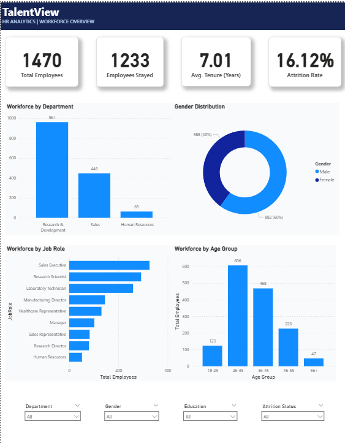
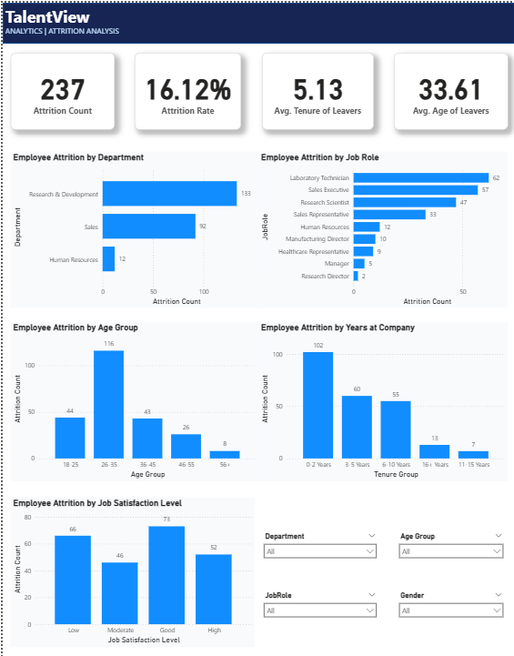

# 📊 TalentView – HR Analytics Dashboard

  <strong>Turning Employee Data into Actionable Workforce Insights</strong>

  
  
  
  

---

## 📌 Project Overview

**TalentView** is an interactive HR Analytics Dashboard developed using Microsoft Power BI to analyze employee workforce data and understand employee attrition patterns.

The dashboard transforms employee data into meaningful insights, helping HR teams explore workforce distribution, identify attrition trends, and understand factors associated with employee turnover.

**Dataset:** IBM HR Analytics Employee Attrition & Performance

- **1,470** employee records
- **35** attributes
- **2** interactive dashboard pages

---

## 📷 Dashboard Preview

### 1. Workforce Overview

Provides a high-level view of the organization's workforce, including employee count, active employees, average tenure, and attrition rate.

### 2. Attrition Analysis

Explores employee attrition across departments, job roles, age groups, tenure groups, and job satisfaction levels.

---

## 📈 Key Workforce Metrics

| Metric | Value |
|---|---:|
| Total Employees | 1,470 |
| Employees Stayed | 1,233 |
| Employees Left | 237 |
| Overall Attrition Rate | 16.12% |
| Average Tenure of Leavers | 5.13 Years |
| Average Age of Leavers | 33.61 Years |

---

## 🔍 Dashboard Features

### Workforce Overview
- Total employee count and active workforce analysis
- Average employee tenure
- Overall attrition rate
- Workforce distribution by department
- Gender distribution
- Employee distribution by job role
- Age group analysis

### Attrition Analysis
- Employee attrition by department
- Attrition by job role
- Attrition across age groups
- Attrition by years at company
- Attrition by job satisfaction level
- KPI analysis of employees who left

### Interactive Filtering
- Department
- Gender
- Education
- Job Role
- Age Group
- Attrition Status

---

## 🛠️ Tools & Technologies

| Technology | Usage |
|---|---|
| Microsoft Power BI | Dashboard development |
| Power Query | Data transformation |
| DAX | Calculated measures and KPIs |
| Data Modeling | Dimension tables and relationships |
| Data Visualization | Interactive charts and reports |

---

## 📂 Repository Contents

| File | Description |
|---|---|
| `TalentView_HR_Analytics.pbix` | Complete Power BI dashboard |
| `HR-Employee-Attrition.csv` | Source dataset |
| `Page1_Workforce_Overview.png` | Workforce dashboard preview |
| `Page2_Attrition_Analysis.png` | Attrition dashboard preview |

---

## 📊 Dataset Information

This project uses the **IBM HR Analytics Employee Attrition & Performance** dataset.

The dataset contains employee-related attributes such as age, department, job role, education, job satisfaction, monthly income, years at company, and attrition status.

---

## 👨‍💻 Author

**Devaraj**

B.Tech – Artificial Intelligence and Data Science

- GitHub: [@Deva0703](https://github.com/Deva0703)
- LinkedIn: [Devaraj – Data Analyst](https://www.linkedin.com/in/devarajdataanalyst/)

---

  <strong>TalentView – Making Workforce Data Meaningful.</strong>

